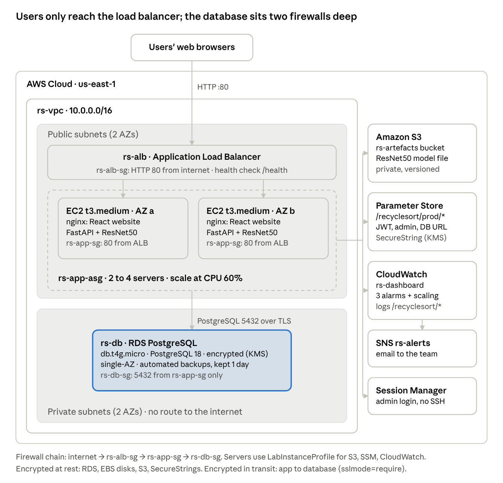

# RecycleSort — Recycling Gamification Web App

University module **INF2006 Cloud Computing and Big Data**, LAB-P2 Group 16. A student uploads a photo of a waste item. A ResNet50 classifier labels it as battery, biological, cardboard, clothes, glass, metal, paper, plastic, shoes, or trash, the app states whether it goes in the blue recycling bin, a special collection point, or general waste, and the user earns points for each upload.

## Problem statement

Campus bins are often contaminated because students cannot tell recyclable materials apart at the moment of disposal, so recyclable items end up in the wrong bin. RecycleSort turns that decision into a short, scored workflow: upload a photo, get the waste category and the correct bin with a short disposal note, and earn points (1 per scan, +4 when the item is blue-bin recyclable) so correct sorting becomes a habit.

## Team

| Name | Student ID | Role |
| --- | --- | --- |
| Happy Calista | 2503673 | Authentication and user management |
| Balandra Dyanel Lancea Estillore | 2502025 | Image upload and input validation |
| Chia Ting Hui Wileen | 2503459 | ML classification and recyclable logic |
| Felicia Seah Yun Xin | 2502426 | Gamification, logging, and database |
| Leong Jia En Melissa | 2503686 | Frontend and AWS deployment |

Contributions, commits, evidence ownership and reflections: `TEAM_CONTRIBUTIONS.md`.

## Quick start (local)

Prerequisites: Python 3.11+, Node.js 20+, Git LFS (only needed for the real model file).

### Backend (FastAPI)

```bash
python -m venv .venv
source .venv/bin/activate
pip install -r src/requirements.txt
cp src/.env.example src/.env
git lfs pull          # downloads src/app/ml/artefacts/resnet50_final.keras (about 225 MB)
cd src && uvicorn app.main:app --reload --host 0.0.0.0 --port 43181
```

Without `git lfs pull` the model file is only a small LFS pointer, and the app falls back to a mock classifier so the workflow can still be tested offline.

Health check: `GET http://127.0.0.1:43181/health` returns 200 when the database is reachable and 503 when it is not.

Locally the app uses SQLite from `src/.env`. In production, `APP_ENV=production` makes it read the JWT key, admin key and database URL from AWS Systems Manager Parameter Store (`/recyclesort/prod/`).

### Frontend (React + Vite)

```bash
cd src/frontend
npm install
npm run dev -- --host 0.0.0.0 --port 43180
```

Open the Vite URL. API calls to `/api` and `/health` are proxied to the FastAPI process.

Local admin dashboard access uses `SSM_ADMIN_API_KEY` from `src/.env` (placeholder in `.env.example`: `dev-admin-api-key-not-for-production`).

### Automated tests

```bash
python -m pytest
```

`tests/test_api.py` covers the upload workflow, missing token (401), fake image (400), file over 5 MB, login rate limit, admin key (403) and `/health` returning 503 without a database. `tests/load_test.py` is the load generator used for Test 4B against the AWS load balancer.

### Reproducing the model evaluation

See `analytics/README.md`. The training and evaluation notebook is `analytics/cloudmodel.ipynb`; results are in `analytics/results/`.

## Architecture



Deployed on AWS (us-east-1, AWS Academy Learner Lab) as IaaS in the public cloud: VPC `rs-vpc` (2 public and 2 private subnets across 2 Availability Zones), Application Load Balancer `rs-alb`, Auto Scaling group `rs-app-asg` (2–4 t3.medium instances from AMI `rs-app-ami-v1`, scale out at 60% CPU), RDS PostgreSQL `rs-db` in private subnets, Parameter Store SecureStrings, S3 for the model file, and CloudWatch with SNS alerts. Security groups form a chain `rs-alb-sg` → `rs-app-sg` → `rs-db-sg`. The full service list is in `project_manifest.yaml`; the build steps are in `evidence/deployment-record.md`.

The AWS resources are kept running for a few days after submission for marking and will then be deleted. The exported configuration in `evidence/config/` and the dated test evidence in `evidence/` are the record of the deployment.

## Evidence

| Test | File |
| --- | --- |
| 1. Functional workflow | `evidence/test-functional.md` |
| 2. Security controls | `evidence/test-security.md`, `evidence/threat-control-map.md` |
| 3. Data/AI validation | `evidence/test-data-ai.md` |
| 4. Scalability and resilience | `evidence/test-resilience.md` |
| Monitoring | `evidence/monitoring.md` |
| Cost | `evidence/cost-log.md` |

## Tech stack

- Backend: Python, FastAPI, SQLAlchemy, Alembic, PyJWT, bcrypt, Pillow
- Frontend: React, TypeScript, Vite
- ML: TensorFlow (CPU) 2.18, ResNet50 fine-tuned on Kaggle Garbage Classification V2; inference in `src/app/ml/`, notebook and scripts in `analytics/`
- Data: held-out test images under `data/testing_images/`; `data/sample_scans.csv` is synthetic; field definitions in `data/DATA_DICTIONARY.md`
- Cloud: AWS VPC, EC2, ALB, Auto Scaling, RDS PostgreSQL, S3, Systems Manager (Parameter Store, Session Manager), KMS, CloudWatch, SNS

## Known limitations

- **HTTP only.** The Learner Lab has no domain or certificate, so the load balancer listens on HTTP. A real deployment needs HTTPS before real passwords are used.
- **Broad IAM role.** The Learner Lab does not allow creating IAM roles, so the servers use `LabRole`, which has more permissions than the app needs. The intended least-privilege policy is in `src/infra/iam-least-privilege-policy.json` but was not applied.
- **Per-server rate limit.** The login rate limit is held in memory on each server, so with 2 servers it blocked at attempt 10 instead of 6. A shared store would fix this.
- **Closed set of classes.** The model always picks one of the 10 classes, even for objects outside them, and has no "unknown" answer. Glass/plastic and paper/cardboard are the most common mix-ups.
- **Clean training images.** Accuracy (94.86% on 1,848 held-out images) was measured on images from the same dataset; real campus photos may score lower.
- **Cold start.** A new server loads the 225 MB model on its first request (about 10 seconds).
- **Single-AZ database.** RDS runs as one small instance with 1-day backups; Multi-AZ is not available in the Learner Lab.

## Repository layout

```
src/          Runnable app, server config (src/infra/), dependencies, .env.example
data/         Sample data, held-out test images and data dictionary
analytics/    Training/evaluation notebook, scripts and results
evidence/     Dated test outputs, exported AWS config, screenshots and diagram
tests/        Automated API tests and load-test script
migrations/   Alembic database migrations
```

See `project_manifest.yaml` for required metadata, evidence paths, and run commands.